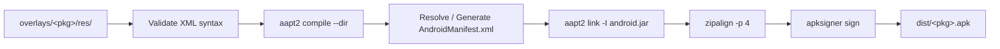

# Kế hoạch triển khai: Workflow Auto-Build Language Overlay cho HyperOS CN

## Goal Description
Xây dựng hệ thống tự động biên dịch (compile), căn chỉnh (zipalign) và ký (sign) các **Runtime Resource Overlay (RRO)** ngôn ngữ từ các file XML (`values-*`) lưu trong repository thành các file `.apk` riêng lẻ cho ROM HyperOS CN. Hệ thống hỗ trợ chạy cả trên **GitHub Actions CI/CD** lẫn **máy cá nhân (local)**.

---

## User Review Required

> [!IMPORTANT]
> **Quy ước cấu trúc & Manifest tự động**
> - Mỗi app mục tiêu sẽ nằm trong thư mục `overlays/<target_package>/` (ví dụ: `overlays/com.android.settings/`, `overlays/com.miui.home/`).
> - Nếu bạn không đặt sẵn `AndroidManifest.xml` trong thư mục app, script sẽ **tự động sinh** `AndroidManifest.xml` chuẩn RRO (`android:isStatic="true"`, `android:priority="100"`) dựa trên `overlay.json` (nếu có) hoặc tên thư mục.
> - Nếu app cần thuộc tính đặc biệt (như `android:targetName="MiuiSettings"` hoặc `requiredSystemProperty`), bạn có thể khai báo trong `overlay.json` hoặc đặt `AndroidManifest.xml` tùy chỉnh.

> [!NOTE]
> **Ký APK (Signing)**
> - Mặc định, nếu không cấu hình keystore riêng, script sẽ tự tạo một debug keystore tạm (`build/debug.keystore`) bằng `keytool` để việc build local và kiểm thử trên PR luôn chạy được ngay.
> - Trên GitHub Actions, bạn có thể thêm Secrets (`KEYSTORE_BASE64`, `KEYSTORE_PASS`, `KEY_ALIAS`, `KEY_PASS`) để ký bằng key chính thức khi release.

---

## Proposed Changes

### Configuration & Project Structure
Thiết lập cấu trúc thư mục chuẩn và cấu hình mặc định cho HyperOS CN (mặc định API 35 / Android 15, có thể chỉnh trong `config.json` hoặc qua tham số CLI).

#### [NEW] [config.json](file:///home/hzzmonet/Downloads/aweyuki/multilang/config.json)
Cấu hình mặc định toàn cục:
```json
{
  "compileSdk": 35,
  "minSdk": 33,
  "targetSdk": 35,
  "overlayPackagePrefix": "com.aweyuki.multilang",
  "defaultPriority": 100,
  "defaultIsStatic": true
}
```

#### [NEW] [.gitignore](file:///home/hzzmonet/Downloads/aweyuki/multilang/.gitignore)
Loại trừ các thư mục tạm và file nhạy cảm: `build/`, `dist/`, `out/`, `*.keystore`, `*.jks`, `*.idsig`, `__pycache__/`.

---

### Build Script (Local & CI)
Sử dụng **Python 3** (chỉ dùng thư viện chuẩn, không cần cài thêm package ngoài) để điều phối `aapt2`, `zipalign`, `apksigner`, và `keytool`.

#### [NEW] [scripts/build_overlays.py](file:///home/hzzmonet/Downloads/aweyuki/multilang/scripts/build_overlays.py)
Pipeline xử lý cho từng overlay (hỗ trợ chạy song song bằng `ThreadPoolExecutor`):



Các tính năng chính của script:
- **Auto-discover Android SDK**: tự tìm `aapt2`, `zipalign`, `apksigner`, và `platforms/android-<compileSdk>/android.jar` từ `ANDROID_HOME`, `ANDROID_SDK_ROOT`, `~/Android/Sdk`, `/opt/android-sdk`, hoặc `PATH`.
- **XML Pre-validation**: kiểm tra cú pháp toàn bộ file `.xml` trong `res/` trước khi chạy `aapt2` để báo lỗi rõ file nào sai.
- **Manifest Resolution**: ưu tiên `AndroidManifest.xml` có sẵn -> nếu không có sẽ đọc `overlay.json` + `config.json` để sinh manifest RRO hợp lệ.
- **Filtering**: hỗ trợ `--only pkg1,pkg2` để build nhanh một vài overlay khi test local, hoặc build tất cả mặc định.

---

### Sample Overlay
Tạo 1 overlay mẫu tối thiểu để kiểm chứng pipeline hoạt động end-to-end (bạn có thể sửa hoặc xóa sau).

#### [NEW] [overlays/com.android.settings/overlay.json](file:///home/hzzmonet/Downloads/aweyuki/multilang/overlays/com.android.settings/overlay.json)
```json
{
  "targetPackage": "com.android.settings",
  "priority": 100,
  "isStatic": true
}
```

#### [NEW] [overlays/com.android.settings/res/values-vi/strings.xml](file:///home/hzzmonet/Downloads/aweyuki/multilang/overlays/com.android.settings/res/values-vi/strings.xml)
File `strings.xml` mẫu tối thiểu hợp lệ để `aapt2` compile và link thành công.

---

### GitHub Actions Workflow
Tự động build khi push code, mở PR, chạy thủ công (`workflow_dispatch`), hoặc tạo Release khi đẩy tag `v*`.

#### [NEW] [.github/workflows/build-overlays.yml](file:///home/hzzmonet/Downloads/aweyuki/multilang/.github/workflows/build-overlays.yml)
- **Triggers**:
  - `push` vào `main` (khi thay đổi `overlays/**`, `scripts/**`, `config.json`, hoặc chính workflow)
  - `pull_request` vào `main`
  - `push` tag `v*` (tự động tạo GitHub Release đính kèm tất cả file `.apk`)
  - `workflow_dispatch` (nhập tùy chọn filter overlay, `compile_sdk`, và bật/tắt tạo Release)
- **Environment**: `ubuntu-latest`, Java 17 (`actions/setup-java@v4`), Android SDK (`android-actions/setup-android@v3`) với `build-tools;35.0.0` và `platforms;android-35`.
- **Outputs**:
  - Upload toàn bộ `dist/*.apk` lên GitHub Actions Artifacts (`actions/upload-artifact@v4`).
  - Đính kèm trực tiếp các file `.apk` vào GitHub Release khi trigger theo tag hoặc `workflow_dispatch` có chọn release.

---

### Documentation

#### [NEW] [README.md](file:///home/hzzmonet/Downloads/aweyuki/multilang/README.md)
Hướng dẫn chi tiết:
- Cấu trúc thư mục và cách thêm overlay mới cho các app HyperOS CN.
- Cách chạy build trên máy cá nhân (`python3 scripts/build_overlays.py`).
- Cách cấu hình GitHub Secrets cho signing key và cách tạo Release.

---

## Verification Plan

### Automated Tests
1. Kiểm tra cú pháp Python và chạy unit/dry-run test cho logic sinh manifest & validate XML:
   ```bash
   python3 -m py_compile scripts/build_overlays.py
   python3 scripts/build_overlays.py --help
   ```
2. Nếu cài đặt Android SDK build-tools trên local (hoặc sau khi push lên GitHub Actions), chạy full build:
   ```bash
   python3 scripts/build_overlays.py --out dist
   ```
   Và kiểm tra APK đầu ra:
   - Tồn tại file `dist/com.android.settings.apk`
   - `apksigner verify dist/com.android.settings.apk` trả về exit code 0

### Manual Verification
- Kiểm tra tab **Actions** trên GitHub sau khi push để xác nhận workflow `build-overlays.yml` chạy thành công và xuất ra artifact chứa `com.android.settings.apk`.
- (Tùy chọn) Cài thử hoặc đẩy file `.apk` lên thiết bị chạy HyperOS CN để xác nhận overlay nhận diện đúng package mục tiêu.
